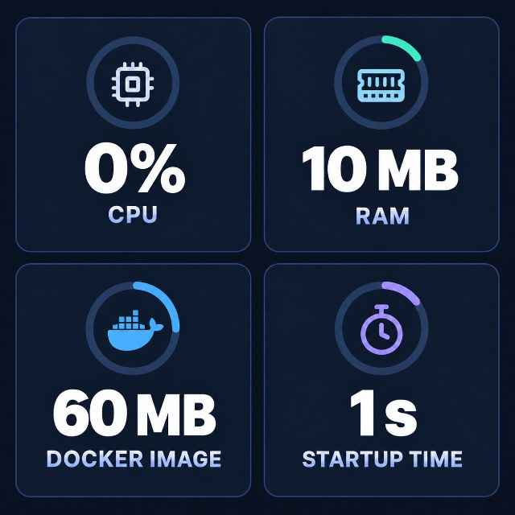
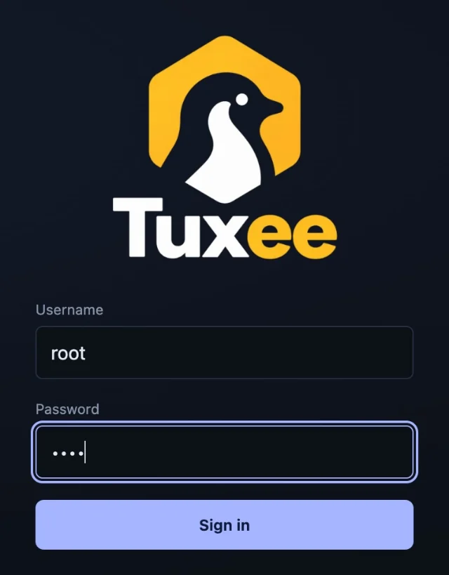
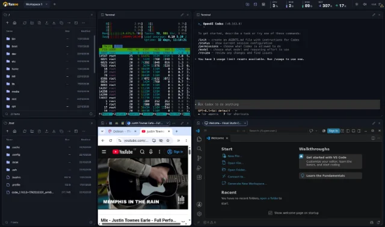
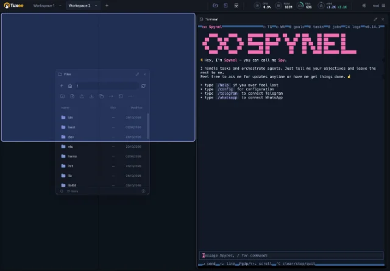
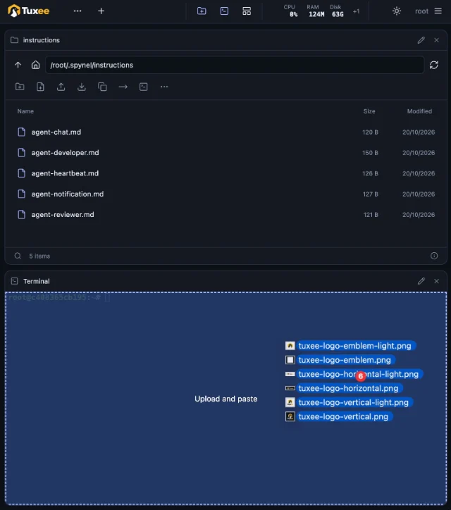
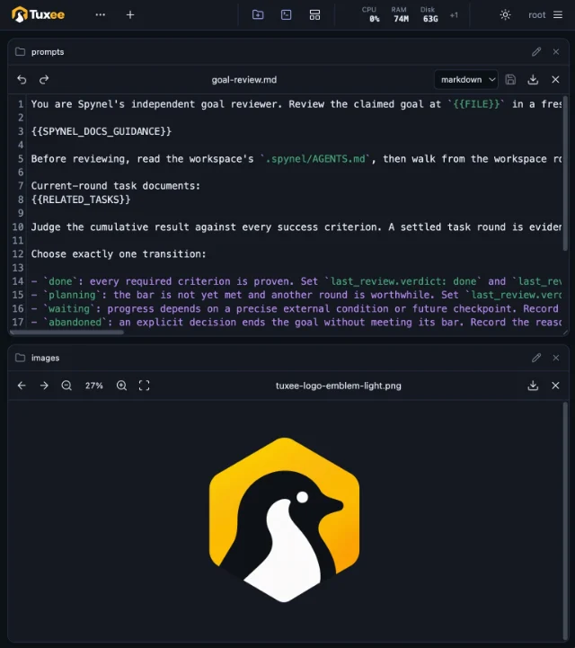

<p align="center">
  <picture>
    <source media="(prefers-color-scheme: dark)" srcset="web/tuxee-logo-vertical.webp">
    
  </picture>
</p>

# Tuxee - the most convenient linux for servers and agents.

A tiny Debian Linux container with a superb web interface for files and <b>(persistent!)</b>
terminals. Also available as a standalone web interface for existing Linux servers.

<h4>Great for admins, perfect for AI agents.</h3>

## Highlights

<table>
  <tr>
    <td width="50%" align="center" valign="middle">
      <a href=".github/resources/screenshots/lightweight-metrics.jpg" target="_blank" rel="noopener noreferrer">
        
      </a>
    </td>
    <td width="50%" valign="middle">
      <h3>Lightweight and fast</h3>
      <p>Based on Debian slim.<br>Core written in Go.<br>No bloat.</p>
    </td>
  </tr>
  <tr>
    <td width="50%" valign="middle">
      <h3>Web interface automatically exposed</h3>
      <p>Log in as a real Linux user.<br>No config needed.</p>
    </td>
    <td width="50%" align="center" valign="middle">
      <a href=".github/resources/screenshots/linux-user-login.webp" target="_blank" rel="noopener noreferrer">
        
      </a>
    </td>
  </tr>
  <tr>
    <td width="50%" align="center" valign="middle">
      <a href=".github/resources/screenshots/file-managers-persistent-terminals.webp" target="_blank" rel="noopener noreferrer">
        
      </a>
    </td>
    <td width="50%" valign="middle">
      <h3>File managers and <b>(persistent!)</b> terminals. That's all you need.</h3>
      <p>Easy access to server files and terminals that don't die when you log out.</p>
      <p>Great for system admins, perfect for running agents.</p>
      <p><strong>Oh, and GUI apps work great too!</strong></p>
    </td>
  </tr>
  <tr>
    <td width="50%" valign="middle">
      <h3>Smooth and natural UX</h3>
      <ul>
        <li>Workspace tabs to organize your work</li>
        <li>Drag and resize windows with grid snapping</li>
        <li>Convenient auto layouts prioritizing terminals or file browsers</li>
      </ul>
    </td>
    <td width="50%" align="center" valign="middle">
      <a href=".github/resources/screenshots/workspaces-grid-layouts.webp" target="_blank" rel="noopener noreferrer">
        
      </a>
    </td>
  </tr>
  <tr>
    <td width="50%" align="center" valign="middle">
      <a href=".github/resources/screenshots/drag-drop-uploads.webp" target="_blank" rel="noopener noreferrer">
        
      </a>
    </td>
    <td width="50%" valign="middle">
      <h3>Drag 'n' drop anything</h3>
      <p>Drag files between windows to move or copy them, or paste their paths into terminals.</p>
      <p>Drag files from your computer into the interface to upload them, or drop them directly into terminals.</p>
      <p>Give your agents files with ease.</p>
    </td>
  </tr>
  <tr>
    <td width="50%" valign="middle">
      <h3>Edit and view</h3>
      <p>Built-in file editor with syntax highlighting and large file support.</p>
      <p>Built-in media viewer.</p>
    </td>
    <td width="50%" align="center" valign="middle">
      <a href=".github/resources/screenshots/editor-media-viewer.webp" target="_blank" rel="noopener noreferrer">
        
      </a>
    </td>
  </tr>
</table>

## Quick start

**Recommended: run the tiny Docker image with zero configuration.**

```sh
docker run -p 80:80 -p 443:443 agent0ai/tuxee
```

The app is available on HTTP 80 and HTTPS 443. Behind Traefik or another HTTPS
proxy, forward to container port **80**—no Tuxee configuration is needed.
See [Docker setup](docs/guide.md#docker) for persistence and alternate host ports.

Open `https://localhost` (or `https://<server-ip>`) in your browser. Log in as
**root** with password **toor**, then run `passwd` in a terminal to change it.
Or preset the password by adding `-e ROOT_PASSWORD='your-password'` before the
image name.

**Or install directly on an existing Linux server:**

```sh
curl -fsSL https://tuxee.agent-zero.ai/install.sh | sudo sh
```

[Manual installation and building from source](docs/install.md)

## Resources

- [Docker setup](docs/guide.md#docker)
- [User and developer guide](docs/guide.md)
- [Updates, releases and repository setup](docs/releases.md)
- [Startup scripts](docker/init/README.md)
- [Optional configuration](docs/guide.md#optional-configuration)
- [Third-party notices](THIRD_PARTY_NOTICES.md)

---

<p align="center">
  Made by <a href="https://agent-zero.ai">Agent Zero</a>
</p>
<p align="center">
  <a href="https://agent-zero.ai">Website</a> ·
  <a href="https://github.com/agent0ai">GitHub</a> ·
  <a href="https://discord.gg/B8KZKNsPpj">Discord</a> ·
  <a href="https://x.com/Agent0ai">X</a> ·
  <a href="https://www.youtube.com/@AgentZeroFW">YouTube</a> ·
  <a href="https://github.com/sponsors/agent0ai">Sponsor</a>
</p>
